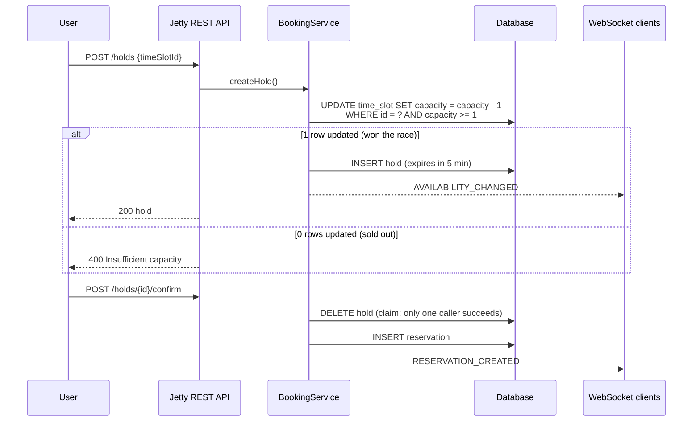

# Reservo: Transaction-Safe Resource Reservation

[](https://github.com/SnigdhaSrivastva/reservo/actions/workflows/ci.yml)


A booking backend for shared campus resources (study rooms, sports courts, lab benches) where **many users compete for limited, time-boxed capacity**. Its core guarantee: **a slot is never oversold**, even when dozens of requests arrive at the same moment.

> Team project for NYU CS9053 (Java), Fall 2025, by **Snigdha Srivastva** and **Utkarsh Mittal**.

## How booking works



**Concurrency design**
- **Atomic capacity reservation.** A hold reserves capacity with one conditional `UPDATE … WHERE capacity_remaining >= qty`. The database serializes these updates, so when N users race for the last unit, exactly one gets a row back.
- **Claim-by-delete.** Confirm, cancel and the expiry sweeper all start by deleting the hold row, and only the caller whose `DELETE` affected a row continues. A hold therefore becomes at most one reservation, and its capacity is released at most once.
- **Idempotency keys.** Clients can send a `requestId`, and retried requests return the original hold or reservation instead of booking twice.
- **Hold expiry and waitlist.** A scheduler releases expired holds and promotes the FIFO waitlist when capacity frees up.
- **Audit trail.** Every state transition is appended to `audit_event`.

## Tests

`mvn test` runs 17 tests. They include multi-threaded races that release 24 workers at once through a latch:

| Test | Asserts |
|---|---|
| `onlyOneUserCanHoldTheLastUnit` | 24 concurrent holds on capacity 1 → exactly 1 succeeds, capacity ends at 0 |
| `capacityIsNeverOversold` | 24 concurrent holds on capacity 5 → exactly 5 succeed |
| `aHoldCanBeConfirmedOnlyOnce` | 8 concurrent confirms of one hold → exactly 1 reservation |
| `cancellingAHoldReleasesCapacity` | cancel returns capacity and another user can book |
| `MigrationRunnerTest` | SQL splitter handles comments, quotes, and apostrophes inside comments |
| `SlotGeneratorTest` | slots fill opening hours, skip the past, drop partial slots |
| `PasswordUtilTest` | salted PBKDF2 hashing, verification, malformed input |

## Architecture

```
src/main/java/reservo/
├── server/     Jetty 10 HTTP servlets + WebSocket endpoint (/ws)
├── service/    BookingService, SchedulerService (expiry, waitlist), SlotGenerator
├── database/   JDBC DAOs, HikariCP pool, SQL migration runner
├── model/      Domain objects (Resource, TimeSlot, Hold, Reservation, …)
├── client/     JavaFX desktop client
└── common/     Config, PBKDF2 password hashing
src/main/resources/migrations/   versioned schema + seed data
```

**Stack:** Java 21 · Jetty 10 (servlets + WebSocket) · JDBC · HikariCP · H2 (dev) / PostgreSQL · Jackson · JavaFX · JUnit 5 · Maven · GitHub Actions

## Run it

Requires Java 21 and Maven.

```bash
mvn package
java -jar target/reservo-1.0.0-jar-with-dependencies.jar   # http://localhost:8080
```

It starts on an in-memory H2 database, runs migrations, seeds demo data and generates bookable slots. Demo logins: `admin / admin123`, `alice / test123`.

```bash
# log in
TOKEN=$(curl -s -X POST localhost:8080/auth/login -H 'Content-Type: application/json' \
  -d '{"username":"alice","password":"test123"}' | jq -r .token)

# find an open slot, hold it, confirm it
curl -s "localhost:8080/availability?resourceId=1&from=2026-01-01T00:00:00Z&to=2030-01-01T00:00:00Z" | jq '.[0]'
curl -s -X POST localhost:8080/holds -H "Authorization: Bearer $TOKEN" -H 'Content-Type: application/json' -d '{"timeSlotId":1}'
curl -s -X POST localhost:8080/holds/1/confirm -H "Authorization: Bearer $TOKEN" -H 'Content-Type: application/json' -d '{}'
```

JavaFX client: `mvn javafx:run`

To use PostgreSQL, set `db.use_h2=false` and the `db.url / db.user / db.password` values in `src/main/resources/config.properties`.

## API

| Method | Path | Description |
|---|---|---|
| POST | `/auth/register`, `/auth/login` | Create account / get bearer token |
| GET | `/resources` | List resources |
| GET | `/availability?resourceId=&from=&to=` | Slots with remaining capacity |
| POST | `/holds` | Hold a slot (`timeSlotId`, optional `qty`, `requestId`) |
| POST | `/holds/{id}/confirm` | Turn a hold into a reservation |
| DELETE | `/holds/{id}` | Release a hold |
| POST | `/reservations/{id}/cancel` | Cancel a reservation |
| POST | `/waitlist` | Join the waitlist for a full slot |
| GET | `/notifications` | User notifications |
| POST | `/admin/isolation-mode` | Switch transaction isolation level (admin) |
| WS | `/ws` | Live availability and reservation events |

## Configuration

`src/main/resources/config.properties`: database, port, hold duration (default 5 min), expiry-sweep and waitlist intervals, connection-pool size, isolation level, and the opening hours and time zone used to generate slots.
